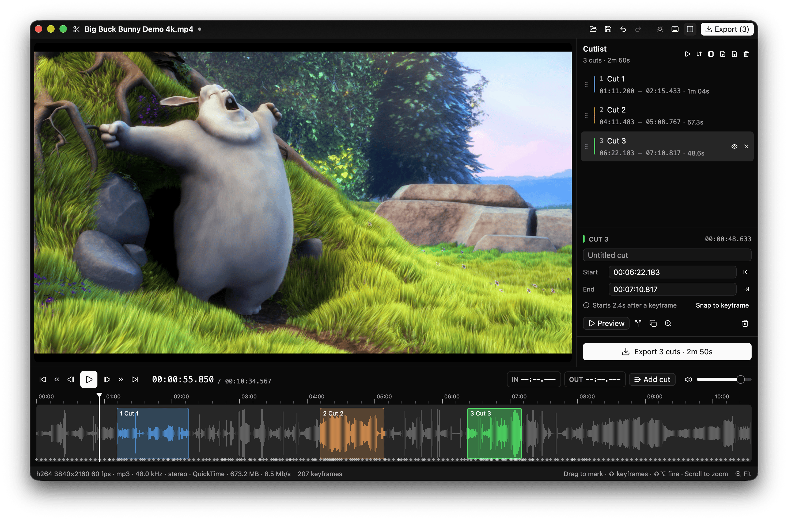

# gpui-cut

A native, lossless video and audio cutter built with
[GPUI](https://www.gpui.rs) and [gpui-kit](https://gpui-kit.com).

Build up a cutlist from one file or several, then render all its cuts
at once, either joined into a single file or as separate files.
Cuts are stream-copied with ffmpeg, so there is no re-encoding: exports are
quick and lose no quality.



## Features

- **Frame-accurate preview** with synchronized audio and hardware-accelerated
  decoding. Scrubbing shows the nearest keyframe while you drag and the exact
  frame when you let go.
- **Jump to any timestamp** (`G` or `⌘J`, or click the timecode). The field
  understands:
  - `1:23:45.5`, `83:20`, `90`: hours:minutes:seconds
  - `90s`, `2m30s`, `1h 5m`, `250ms`: units
  - `+10`, `-1:00`, `+12f`: relative to the playhead
  - `50%`: a fraction of the file
  - `f1200` / `1200f`: a frame number
  - `start`, `end`
- **Cutlist** spanning multiple files: reorder by dragging, include or
  exclude cuts, rename (double-click a cut's name), split, duplicate, sort,
  invert ("keep everything between the cuts"), add the whole file as one cut,
  and turn chapters into cuts. `⇧P` plays every included cut in cutlist
  order, switching files as needed, so you can hear and see the result before
  exporting.
- **Cut details** for the selected cut, below the cutlist: edit its name,
  start and end (the time fields take the same syntax as jump to timestamp),
  set either edge to the playhead, move the start back to the previous
  keyframe when it isn't on one, play it, split it, duplicate it, zoom the
  timeline to it, or delete it.
- **Several files at once**, each in its own tab with its own zoom. A tab can
  be closed once its cuts are removed from the cutlist.
- **Timeline** with waveform, keyframe markers, chapter markers, zoom
  (scroll) and pan (shift-scroll), and an overview strip when zoomed.
  Drag across the track to mark a range (double-click it to add it as a cut),
  drag the ruler or playhead to scrub, and drag cut edges to trim. Edges snap
  to the playhead, marks, other cuts and keyframes. While dragging:
  - hold `⌥` to turn snapping off
  - hold `⇧` to jump between keyframes only
  - hold `⇧⌥` to move at a tenth of the speed, showing exact frames. Adding
    `⌥` while on a keyframe fine-tunes from that keyframe.
- **Keyframe awareness**: step between keyframes, see whether a cut starts on
  a keyframe, and snap it there with one click.
- **Export** as one merged file (with a chapter per cut) or as separate files,
  with control over container format, output folder (or next to each source
  file), file names (`{name}`, `{from}`, `{to}`, `{duration}`, `{n}`,
  `{label}`, `{suffix}`, `{date}`, with a live preview), which tracks to keep
  from each file, keyframe vs. exact cutting, timestamp shifting, metadata,
  keeping the source's chapters, faststart and experimental codecs. Existing
  files are never overwritten unless you turn on "Overwrite existing files".
  When the export finishes you can open the result or show it in its folder.
- **Save the current frame** as a JPEG (`C`).
- **Projects**: save and reopen the cutlist (`.gpuicut`), and import/export
  cut lists as CSV (see [CSV cut lists](#csv-cut-lists)).
- Undo/redo for every cutlist edit, light and dark themes, a waveform you can
  hide (View → Show Waveform), the last 8 files on the start screen, a prompt
  to save before closing with unsaved changes, and keyboard shortcuts for
  nearly every action (press `?` for the list).

## Requirements

- Rust 1.88+ (edition 2024)
- `ffmpeg` and `ffprobe` on your `PATH` (or in `/opt/homebrew/bin`,
  `/usr/local/bin`, …). Point to specific binaries with `GPUI_CUT_FFMPEG` and
  `GPUI_CUT_FFPROBE`.

On macOS: `brew install ffmpeg`.

## Running

```sh
cargo run --release -- [files…]
```

Files given on the command line (media, `.gpuicut` projects or `.csv` cut
lists) are opened at startup. You can also drop files onto the window.

To build a double-clickable macOS app:

```sh
./scripts/bundle-macos.sh   # creates target/release/gpui-cut.app
```

The app registers for movie and audio files, so it shows up under Finder's
"Open With".

## Basic workflow

1. Open a video (`⌘O`, or drop it on the window).
2. Move to where a cut should start and press `I`; move to its end and press
   `O`. Use `G` to type an exact time, `,`/`.` to step frames and `⌥←`/`⌥→`
   to step keyframes.
3. Press `Enter` to add the marked range to the cutlist. Repeat across as
   many files as you like.
4. Arrange the cutlist, then press `⌘E` to export.

## Keyboard shortcuts

| Keys | Action |
|---|---|
| `Space` / `K` | Play / pause |
| `P` | Preview the selected cut |
| `⇧P` | Preview the whole cutlist |
| `←` `→` · `J` `L` · `⇧←` `⇧→` | Seek 1 s · 5 s · 10 s |
| `,` `.` | Previous / next frame |
| `⌥←` `⌥→` | Previous / next keyframe |
| `Home` `End` | Start / end |
| `G` / `⌘J` | Jump to timestamp |
| `M` · `⇧↑` `⇧↓` | Mute · volume up / down |
| `I` `O` | Mark in / out |
| `Enter` | Add marked range as a cut |
| `Esc` | Clear marks / cancel |
| `S` | Split cut at playhead |
| `[` `]` | Set cut start / end to playhead |
| `↑` `↓` | Select previous / next cut |
| `⌥↑` `⌥↓` | Move cut up / down |
| `E` | Include / exclude cut |
| `⌘D` · `⌫` / `Del` | Duplicate · delete cut |
| `C` | Save current frame as an image |
| `=` `-` `0` `Z` | Zoom in / out / fit / to cut |
| `⌘Z` `⇧⌘Z` | Undo / redo |
| `⌘O` · `⌘⇧O` | Open media · open project |
| `⌘S` · `⌘⇧S` | Save project · save as |
| `⌘E` | Export |
| `?` | Show all shortcuts |

## Mouse

| Gesture | Action |
|---|---|
| Click or drag the ruler, or drag the playhead | Seek / scrub |
| Drag across the track | Mark a range |
| Double-click inside the marked range | Add it as a cut |
| Click a cut | Select it |
| Double-click a cut, or its row in the cutlist | Play it |
| Drag a cut's edge | Trim it |
| Hold `⇧` while dragging | Stick to keyframes |
| Hold `⇧⌥` while dragging | Fine adjust at 1/10 speed |
| Hold `⌥` while dragging | Don't snap |
| Scroll · `⇧` scroll | Zoom · pan the timeline |
| Click the strip under a zoomed timeline | Jump the view there |
| Double-click a cut's name in the cutlist | Rename it |
| Drag a cutlist row | Reorder it |
| Drop files on the window | Open them |

## How exporting works

Each cut is stream-copied with ffmpeg:

- **Keyframe cut** (default) seeks on the input (`-ss` before `-i`), so the
  cut begins on the keyframe at or before its start and always plays
  cleanly. The app warns when a cut doesn't start on a keyframe and offers to
  snap it.
- **Exact cut** seeks on the output (`-ss` after `-i`), starting exactly at
  the requested time; video may be frozen or garbled until the next keyframe.

In merge mode, cuts are first written as hidden temporary parts next to the
output and then joined with ffmpeg's concat demuxer (adding a chapter per
cut). Temporary files are removed afterwards, and partial outputs are removed
if an export fails or is cancelled. Merging cuts from files with different
encodings is flagged with a warning, since stream-copy joins require matching
streams.

When a cut doesn't start on a keyframe, or a track can't be stored in the
chosen container (it is skipped), the export dialog says so before you start.

## CSV cut lists

Exported lists have one `start,end,label` row per cut, with times as
`HH:MM:SS.mmm`. Imports also accept `;` or tab delimiters, an optional header
row, times in plain seconds, and an empty end meaning "to the end of the
file". Imported cuts go to the file that is open.

## Settings

Export options, volume, theme, the waveform toggle and recent files are
saved to `gpui-cut/settings.json` in your config directory
(`~/Library/Application Support` on macOS). Set `GPUI_CUT_CONFIG_DIR` to use
another directory.

## Development

```sh
cargo test                    # unit tests
cargo test -- --ignored       # integration tests that run ffmpeg/ffprobe
cargo clippy --all-targets
```

The code is organized as:

- `src/timecode.rs`: timestamp parsing/formatting and the jump syntax
- `src/playlist.rs`: the cutlist model and undo history
- `src/project.rs`: project files, CSV cut lists and settings
- `src/media/`: ffprobe metadata, keyframe index, video decoding, audio
  output, waveform analysis and the synchronized player
- `src/export/`: export options, file naming, ffmpeg argument building,
  planning and execution
- `src/ui/`: the editor, timeline, cutlist panel and export dialog

### Scripted UI automation

Building with `--features automation` enables a small driver for checking the
real UI: set `GPUI_CUT_SCRIPT` to a file of commands such as `wait 500`,
`key cmd-j`, `type 1:23`, `click 400 300`, `drag …`,
`press`/`dragto`/`release`, `mods shift alt`, `scroll …` and
`shot /tmp/screen.png` (see `src/automation.rs`).

```sh
GPUI_CUT_SCRIPT=script.txt cargo run --features automation -- video.mp4
```
